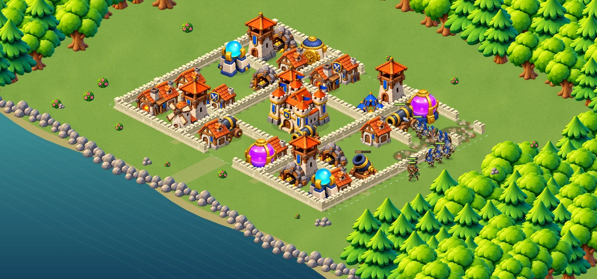

# Valdoria — le village fortifié

La page `royaume/bataille-3d.html` conserve son adresse historique, mais présente désormais le combat illustré en vue isométrique demandé à partir des références en paysage.

## Jouer

Depuis le village : **Combat → Combat · Village fortifié**. Le lien des réglages ouvre également cette page. Après publication : https://one-officiel.fr/royaume/bataille-3d.html?v=6

Le terrain s’ouvre directement. Choisir une carte, puis toucher à l’extérieur de la ligne bleue pour déployer. Le bouton « Déployer au sud » reste disponible. La foudre se lance après sélection de sa carte. Glisser déplace la vue, pincer ou +/− change le zoom. Les commandes comprennent recentrage, plein écran si disponible, mode éco, pause et aide. La page s’adapte au portrait ; le paysage laisse davantage de place au terrain.

L’entraînement fournit 8 gardiens, 6 archers, 3 mages et 2 sorts. Le compte à rebours commence au premier déploiement ou sort. La carte comporte 35 bâtiments et 170 segments de rempart, avec plusieurs enceintes. Les compteurs du coin supérieur indiquent les réserves de cette bataille, les sorts et les cibles restantes — pas les ressources sauvegardées du joueur.

## Rendu

Le terrain utilise Canvas 2D, avec des bâtiments illustrés indépendants et triés en profondeur. Ce rendu 2,5D ne permet pas de tourner librement autour des modèles. Le village n’est pas une image de fond : chaque bâtiment peut être ciblé, subir des dégâts et laisser des décombres.

Les bâtiments viennent des illustrations existantes de Valdoria. Trois nouvelles planches de troupes comportent chacune huit poses : repos, deux pas et attaque, vus de face et de dos. Les unités changent de pose et d’orientation pendant la simulation. Les cartes affichent les mêmes personnages. Les nouvelles images WebP pèsent environ 978 ko au total.

Le sol texturé, les berges, la forêt, les chemins, les projectiles et les effets de destruction sont dessinés dans le moteur. Les éléments fixes du décor sont mis en cache. Le mode éco réduit la résolution et les effets ; la préférence système de réduction des animations est respectée. Les éventuels échecs de chargement d’images gardent un terrain simplifié jouable et sont signalés.

## Simulation et sauvegardes

`battle-style-layout.mjs` définit la carte d’entraînement de 40 × 32. `createTraining` accepte cette carte et ses dimensions en option. Le moteur de déplacement lit ces dimensions lorsqu’elles sont présentes ; les missions existantes conservent leur terrain de 20 × 16 et leurs résultats précédents.

L’état de l’entraînement reste privé et en mémoire. Il n’importe ni moteur de sauvegarde ni connexion au village. Ses récompenses de simulation ne sont jamais transférées au compte du joueur. Le village sauvegardé, les campagnes et les combats entre joueurs ne sont pas remplacés par cette carte.

## Validation

```sh
node --test royaume/tests/battle3d.test.mjs royaume/tests/battle3d-art.test.mjs royaume/tests/battle-startup.test.mjs royaume/tests/battle-style.test.mjs
```

24 tests passent. Ils couvrent notamment le déploiement sur les quatre côtés du grand terrain, les collisions pendant une bataille gagnée, la remise à zéro, les poses des troupes, les commandes de la page et la conservation des résultats des douze missions existantes.

Le rendu Canvas avec les vrais fichiers graphiques a été exécuté et inspecté hors navigateur, avant et pendant une bataille. Les tests des commandes remplacent le DOM et la surface de dessin. La mise en page CSS dans un navigateur réel, les gestes sur appareil et les performances Android restent à vérifier. L’image de référence générée n’est pas une capture du jeu ; l’aperçu ci-dessous provient du moteur Canvas.


