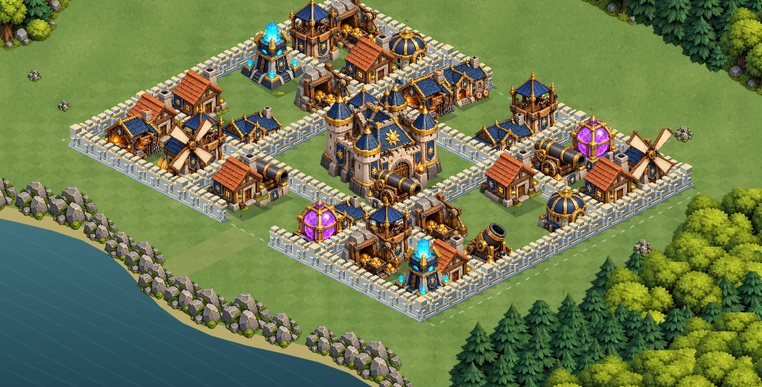

# Combat d’entraînement de Valdoria — version 9

`bataille-3d.html?v=9` ouvre le terrain privé de 35 bâtiments et 170 segments de remparts. La scène utilise des illustrations animées en vue isométrique sur Canvas 2D. L’entraînement reste indépendant du village sauvegardé, des ressources et du PvP.

## Animation et tirs de la version 9

Les troupes disposent maintenant de membres articulés, de gestes distincts pour l’épée, l’arc et le bâton, et d’un espacement progressif. Les défenses montrent leurs projectiles, leurs impacts et le recul des pièces d’artillerie. [Détails, vidéo et validation de la version 9](docs/ANIMATION-V9.md).

## Choix des cibles et déplacements

La version précédente cherchait le bâtiment le plus proche à vol d’oiseau puis, si le trajet échouait, le mur le plus proche. Elle pouvait donc ignorer un autre bâtiment accessible et attaquer une portion de rempart sans intérêt.

La nouvelle navigation cherche d’abord une position d’attaque accessible pour les bâtiments vivants. Elle tient compte des passages libres et des empreintes de collision. Si aucun bâtiment n’est accessible, une recherche pondérée estime le coût du trajet et de la destruction des murs ; l’unité vise alors le premier mur qui bloque ce trajet. Une destruction déclenche une réévaluation immédiate. Les archers et les mages peuvent tirer par-dessus les murs à portée.

Les chemins autorisent les diagonales libres, interdisent de couper les coins des obstacles et retirent les points intermédiaires inutiles après vérification du segment complet. Une route valide reste stable jusqu’à un changement de terrain. L’interpolation entre étapes de simulation est conservée.

Cette navigation s’active uniquement pour le grand terrain privé. Les douze missions historiques conservent leurs règles de déplacement.

## Bâtiments et rendu

Six nouvelles illustrations plus grandes remplacent le château, la tour, le canon, le mortier, la caserne et la forge. Les bâtiments montrent des traces de dommages à deux seuils de santé. Huit illustrations de ruines distinguent les matériaux et les fonctions du bâtiment détruit.

Le cache du décor reconstruit uniquement les groupes dont l’apparence a changé. Les groupes traversés par une troupe conservent leur dessin individuel afin de respecter l’ordre de profondeur. Le mode éco et la préférence de mouvement réduit restent pris en compte.



[Capture des déplacements dans le moteur](docs/mouvements-v8.mp4)

Ces captures utilisent les vraies ressources, la simulation et le moteur Canvas, exécutés hors navigateur. Elles ne comprennent pas l’interface HTML et ne mesurent pas la fluidité d’un téléphone Android.

## Vérifications

```sh
node --test royaume/tests/battle3d.test.mjs royaume/tests/battle3d-art.test.mjs royaume/tests/battle-startup.test.mjs royaume/tests/battle-style.test.mjs royaume/tests/battle-motion.test.mjs royaume/tests/battle-navigation.test.mjs royaume/tests/battle-animation.test.mjs
```

38 tests : animations articulées, tirs et impacts, espacement, cibles accessibles, passage par les ouvertures, brèche utile, tir à distance au-dessus des murs, abandon des murs après ouverture, stabilité des routes, collisions, interpolation, pause, replay, victoire, cache partiel du décor, isolation du village et résultats de référence des 12 missions historiques.

Chargement réel des planches, rendu, mode éco et redémarrage contrôlés avec Canvas natif. Interface et fluidité Android restent à vérifier sur appareil.

Après fusion et déploiement : `https://one-officiel.fr/royaume/bataille-3d.html?v=9`.
