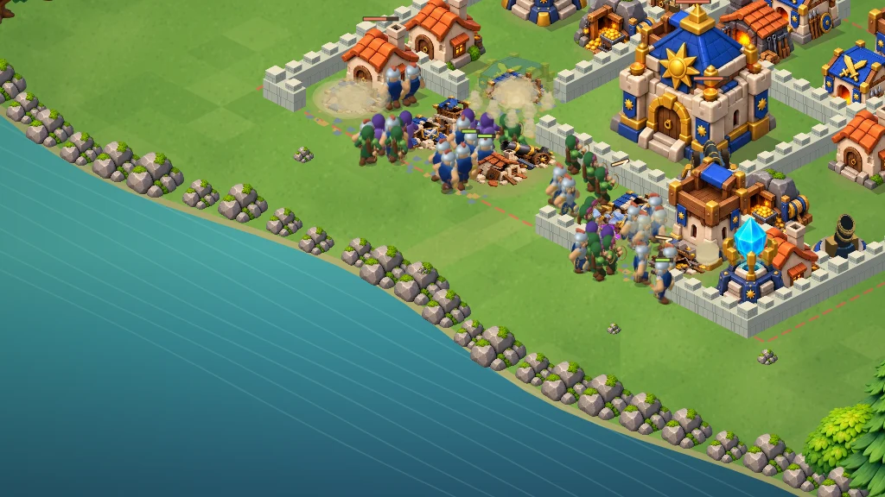

# Combat d’entraînement de Valdoria — version 14

`bataille-3d.html?v=14` ouvre le terrain privé de 35 bâtiments et 170 segments de remparts. La scène utilise des illustrations animées en vue isométrique sur Canvas 2D. L’entraînement reste indépendant du village sauvegardé, des ressources et du PvP.

## Combat v14 : action rapprochée et portée des canons

- Armée de 40 soldats : 20 gardiens, 14 archers et 6 mages. Le bouton du sud déploie jusqu’à cinq soldats du type choisi ; les appuis simples et maintenus restent possibles.
- Le premier déploiement par ce bouton active une vue rapprochée du groupe. Le bouton ◎ active/désactive le suivi, le bouton de recentrage revient au village entier. Toucher le terrain arrête le suivi avant toute projection du doigt, pour conserver un déploiement précis.
- Buste, épaules et mains retravaillés, course plus marquée et frappe du gardien plus ample. Les 16 directions et les points de départ des tirs restent cohérents avec la simulation.
- Traînées de feu, coups d’épée directionnels, impacts avec poussière et effondrement bref des bâtiments/remparts avant les ruines.
- Les **canons tirent sur les unités vivantes dans un rayon de 4,5 cases, même derrière une muraille**. Ils n’acquièrent pas de cible hors de cette zone et annulent leur préparation si elle en sort. Les dégâts attendent toujours l’arrivée du boulet.
- Toucher une défense montre sa portée. Le bouton **Portée** montre les zones des canons. Ces tracés suivent le vrai rayon dans le monde, après zoom ou déplacement ; les défenses détruites n’en affichent plus.

## Présentation héritée de la v13

- Nouvelle planche de 16 bâtiments et éléments naturels, recadrés dans des cases égales avec marges transparentes ; tour sans personnages figés dans l’illustration.
- Remparts en pierre plus épais, connectés et ombrés, avec un cache limité aux 16 masques de connexion. Les fondations suivent le même terrain que les collisions.
- Prairie texturée, variations douces en losanges, terre sous les bâtiments, forêt dégagée autour des bords et rivière continue même en portrait.
- Caméra recentrée entre les compteurs et les cartes. Le zoom et le déplacement restent disponibles ; la conversion du toucher est vérifiée après ces transformations.
- Silhouettes distinctes : gardien à plastron large et panache rouge, archère à cape verte, mage à robe violette. Épée en volume et portraits issus des personnages du jeu.
- Cartes d’armée claires avec sélection relevée, bouton de retour rouge, panneaux de pause/résultat refaits et ligne rouge de déploiement.
- Débris, poussière, fumée des bâtiments très endommagés et réaction brève aux impacts, avec respect du mode éco et de la préférence de mouvement réduit.
- Sons synthétisés facultatifs, activés par le bouton ♫. Aucun fichier audio externe ni lecture automatique. Pause, remise à zéro et sortie libèrent ou suspendent le son.

La v13 reprend la direction des combats de stratégie mobile demandée. Elle reste le moteur et les unités de Valdoria ; l’équivalence visuelle ou les performances de Clash of Clans ne sont pas revendiquées.

## Visée et attaques de la version 14

Les tubes des canons et des mortiers tournent réellement vers leur cible. Leur géométrie, la bouche de tir et le départ du projectile partagent les mêmes coordonnées. Les défenses suivent une cible vivante, anticipent son déplacement, terminent leur rotation et arment leur tir. Les dégâts sont appliqués à l’arrivée du projectile. Le mortier suit une trajectoire en cloche ; son impact inflige des dégâts de zone.

Les soldats accélèrent, tournent avant de repartir, s’arrêtent à portée, préparent leur attaque puis récupèrent. Une unité en train de frapper n’est plus poussée par ses voisines. Les pieds restent fixés au sol pendant la phase d’appui de la marche. Les gestes du gardien, de l’archère et du mage restent distincts. L’orientation des troupes et des défenses est interpolée entre les étapes de simulation.

Un appui maintenu déploie plusieurs soldats du type sélectionné. Glisser, pincer, relâcher ou changer de type interrompt cette répétition. Une position interdite affiche un marqueur rouge et ne dépense aucune troupe.



[Vidéo du combat v14 — seize secondes du moteur réel](docs/combat-v14.mp4)

Cette capture utilise les vraies ressources, la simulation et le moteur Canvas, exécutés hors navigateur. Elle ne comprend pas l’interface HTML et ne mesure pas la fluidité d’un téléphone Android. Le résultat reste une scène isométrique 2,5D originale, pas une reproduction exacte de Clash of Clans.

La base v12 remplaçait les membres illustrés étirés par trois personnages complets modélisés en volume et rendus à l’avance. Chaque troupe possède 16 orientations et 22 poses : repos, 12 phases de marche, préparation, frappe et récupération. Les genoux et les coudes sont calculés dans l’espace du personnage avant leur projection. Le buste accompagne la marche et la frappe ; l’archère tend réellement son arc. Le départ des projectiles est vérifié contre la pointe de l’épée, l’arc et le cristal du bâton dans 16 directions pour chaque troupe. Les impacts déclenchent une réaction visuelle et les soldats vaincus chutent brièvement avant de disparaître. La préférence de mouvement réduit supprime la chute et le flash.

Historique : [animation articulée v9](docs/ANIMATION-V9.md).

## Choix des cibles et déplacements

La version précédente cherchait le bâtiment le plus proche à vol d’oiseau puis, si le trajet échouait, le mur le plus proche. Elle pouvait donc ignorer un autre bâtiment accessible et attaquer une portion de rempart sans intérêt.

La nouvelle navigation cherche d’abord une position d’attaque accessible pour les bâtiments vivants. Elle tient compte des passages libres et des empreintes de collision. Si aucun bâtiment n’est accessible, une recherche pondérée estime le coût du trajet et de la destruction des murs ; l’unité vise alors le premier mur qui bloque ce trajet. Une destruction déclenche une réévaluation immédiate. Les archers et les mages peuvent tirer par-dessus les murs à portée.

Les chemins autorisent les diagonales libres, interdisent de couper les coins des obstacles et retirent les points intermédiaires inutiles après vérification du segment complet. Une route valide reste stable jusqu’à un changement de terrain. L’interpolation entre étapes de simulation est conservée.

Cette navigation s’active uniquement pour le grand terrain privé. Les douze missions historiques conservent leurs règles de déplacement.

## Bâtiments et rendu

La nouvelle planche `fortress-v13.webp` remplace les bâtiments et les arbres du combat : formes compactes, pierre claire, toits bleus ou terre cuite, reliefs arrondis et lumière cohérente. Les huit ruines ont été refaites dans les mêmes matériaux. Le terrain utilise des variations de couleur discrètes et une texture d’herbe. Le canon et le mortier utilisent maintenant un socle illustré et une pièce d’artillerie orientable projetée dans Canvas ; ils ne dépendent pas de WebGL. Les bâtiments montrent des traces de dommages à deux seuils de santé. Huit illustrations de ruines distinguent les matériaux et les fonctions du bâtiment détruit.

Le cache du décor reconstruit uniquement les groupes dont l’apparence a changé. Les groupes traversés par une troupe conservent leur dessin individuel afin de respecter l’ordre de profondeur. Le mode éco et la préférence de mouvement réduit restent pris en compte.

Les poses de l’artillerie utilisent un cache limité à 40 images de 192 × 192 pixels. Les tubes utilisent un tampon de profondeur et un ombrage interpolé, afin de conserver les bonnes occultations lorsqu’ils tournent. Le dessin simplifié reste disponible si les nouveaux socles ne chargent pas.

## Production des personnages

Les fichiers `tools/combat-volume-models.mjs` et `tools/volume-raster.mjs` modélisent et rendent les personnages hors ligne. `tools/bake-volume-troops.mjs` écrit les trois PNG de production, convertis en WebP qualité 84 avec alpha. Une planche mesure 1536 × 2552 pixels, soit 16 colonnes de 96 pixels et 22 lignes de 116 pixels. Le jeu charge uniquement les WebP ; aucun moteur 3D ni compilateur de modèles ne tourne sur le téléphone. Les trois planches occupent environ 1,35 Mo téléchargés et 47 Mo décodées en RGBA, soit 36 % de mémoire en moins que la v12. Ce coût mémoire doit être surveillé sur les téléphones modestes.

```sh
node royaume/tools/bake-volume-troops.mjs
```

Le script utilise `@napi-rs/canvas`, installé séparément, ou le chemin fourni dans `VALDORIA_CANVAS_MODULE`. Les anciennes illustrations articulées restent le secours si une nouvelle planche manque.

## Vérifications

```sh
node --test royaume/tests/battle3d.test.mjs royaume/tests/battle3d-art.test.mjs royaume/tests/battle-startup.test.mjs royaume/tests/battle-style.test.mjs royaume/tests/battle-motion.test.mjs royaume/tests/battle-navigation.test.mjs royaume/tests/battle-animation.test.mjs royaume/tests/battle-coherence.test.mjs royaume/tests/battle-volume.test.mjs royaume/tests/battle-presentation.test.mjs royaume/tests/battle-raid.test.mjs royaume/tests/battle-cannon-range.test.mjs
```

59 tests réussis : 48 combinaisons défense/direction pour l’alignement du tir, délai des dégâts, anticipation des cibles mobiles, arrêt des trois types de troupes pendant leur attaque, annulation si la cible meurt, pieds en appui, rotations interpolées, articulation des genoux, tension de l’arc, 48 correspondances arme/projectile, réaction aux impacts et chute, armée complète depuis chacun des quatre côtés, déploiement continu et annulation des gestes. Les contrôles précédents couvrent aussi les cibles accessibles, les brèches, les collisions, la pause, le replay, les sorts, la victoire, le chargement, le cache du décor et l’isolation du village. Les résultats de référence des 12 missions historiques sont inchangés.

Chargement réel des nouvelles planches, rendu paysage (1024 × 576), cadrage portrait (390 × 720), mode éco et redémarrage contrôlés avec Canvas natif. Le mélange des poses est composé sur une surface transparente avant le décor, pour éviter les silhouettes lumineuses. Toutes les poses générées sont contrôlées contre les découpes de bottes ou d’armes aux bords des cases. Le rendu Canvas natif et les commandes sont vérifiés. La fluidité Android et le son restent à vérifier sur un appareil réel. Les tests de commandes utilisent un DOM simulé.

Après fusion et déploiement : `https://one-officiel.fr/royaume/bataille-3d.html?v=14`.

## Reproduire les aperçus

```sh
VALDORIA_CANVAS_MODULE=/chemin/vers/@napi-rs/canvas/index.js VALDORIA_PREVIEW_DIR=/chemin/vers/aperçus VALDORIA_RENDER_VIDEO=1 node royaume/tools/render-combat-preview.mjs
```

Le script charge les images de production, exécute 16 secondes de combat, exporte les vues paysage et portrait puis vérifie le mode éco et la remise à zéro. Les images et la vidéo présentent le Canvas réel, sans l’interface HTML. Le champ de bataille est rendu à 30 étapes de simulation par seconde ; la vidéo exportée contient 15 images par seconde et ne constitue pas une mesure de FPS sur téléphone.
