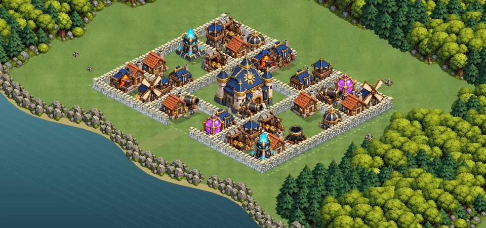

# Combat d’entraînement de Valdoria — version 7

Le chemin historique `bataille-3d.html?v=7` ouvre une bataille isométrique illustrée sur Canvas 2D. Il ne s’agit pas d’une scène 3D à caméra libre. L’entraînement reste gratuit et indépendant du village sauvegardé, des ressources et du PvP.

## Rendu

Le terrain conserve 35 bâtiments destructibles et 170 segments de remparts. Le kit graphique v7 remplace les anciens bâtiments du village dans cet entraînement : château bleu et or, défenses, ateliers, ressources, forêt, rochers et débris. Les remparts emploient le niveau de matériau 6. La barre de troupes est réduite sur les téléphones en paysage.



[Capture des mouvements dans le moteur Canvas](docs/troupes-fluides.mp4)

Ces captures utilisent le vrai moteur, les véritables ressources et la simulation. Elles sont produites hors navigateur avec Canvas natif et ne comprennent pas l’interface HTML. Elles ne mesurent pas les performances d’un téléphone Android.

## Fluidité

- Simulation à pas fixe de 30 Hz ; affichage interpolé entre les deux dernières positions connues à chaque image. Au plus 33 ms de retard visuel, sans prédiction à travers les obstacles.
- Consommation de toute la distance d’un pas au passage d’un point du chemin, sans arrêt artificiel entre les cases.
- Dans ce grand terrain uniquement, conservation temporaire de la cible et réutilisation de la grille de collision jusqu’à une destruction.
- Recalage des pieds et du torse entre les poses, transitions précalculées, orientation amortie et réaction à chaque attaque.
- Cache du décor par groupes triés en profondeur. Lorsqu’une troupe traverse la profondeur d’un groupe, ses éléments sont redessinés dans l’ordre exact pour conserver les occultations.
- Mode éco : densité de pixels réduite et moins d’effets. Préférence de mouvement réduit respectée.

Le routage des douze missions historiques conserve son ancien comportement. Les changements de déplacement et de verrouillage de cible ne s’activent que sur le terrain privé étendu.

## Vérifications

```sh
node --test royaume/tests/battle3d.test.mjs royaume/tests/battle3d-art.test.mjs royaume/tests/battle-startup.test.mjs royaume/tests/battle-style.test.mjs royaume/tests/battle-motion.test.mjs
```

27 tests passent : commandes, collisions, victoire, replay, isolation du village, résultats des 12 missions historiques, interpolation des positions, absence d’arrêt aux cases, pause et ordre d’occultation du cache.

La simulation de 600 étapes avec 17 troupes a demandé en moyenne environ 0,58 ms par étape contre 1,29 ms avant ces corrections dans cet environnement Node. Ces valeurs illustrent la réduction du travail de simulation ; elles ne constituent pas une mesure de FPS sur mobile. Le rendu de l’interface, les gestes réels et la fluidité Android restent à vérifier sur appareil.

## Essai

Après fusion et déploiement : `https://one-officiel.fr/royaume/bataille-3d.html?v=7`. Tourner le téléphone en paysage. Choisir une troupe puis toucher hors de la limite bleue, ou utiliser « Déployer au sud ». Glisser pour déplacer la caméra ; pincer pour zoomer. Pause, replay, plein écran et retour au village restent accessibles.
