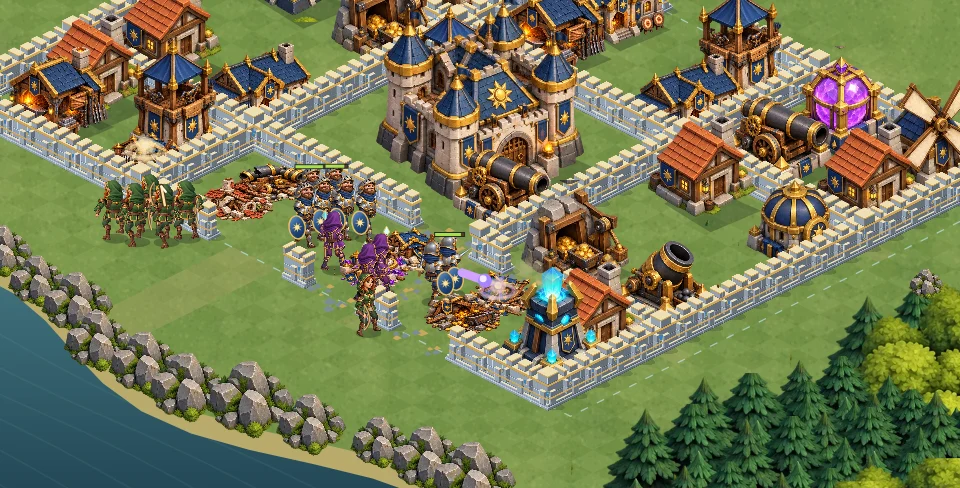

# Valdoria : animation et tirs, version 9

La scène de bataille utilise maintenant des personnages articulés : tête, buste, bras, avant-bras, cuisses et bottes sont dessinés séparément, avec des illustrations de face et de dos. Le mouvement des articulations suit la direction et la distance parcourue, sans fondre deux images complètes l'une sur l'autre. Les gardiens lèvent puis abattent leur épée, les archères arment leur arc et les mages lèvent leur bâton. Les troupes proches s'écartent progressivement en respectant les murs.

Les défenses montrent le départ du tir, son trajet et son impact : flèches des tours, boulets des canons, trajectoires hautes des mortiers et rayons des tours magiques. Canons et mortiers reculent au départ du coup. Les dégâts restent appliqués au même instant par la simulation ; le projectile est leur représentation visuelle, sans nouvelle règle de dégâts différés. Les dégâts de zone n'émettent plus plusieurs projectiles identiques depuis le même tireur.

Le recul est dessiné à la bonne profondeur sans reconstruire le cache du décor. Le mode éco conserve les tirs nécessaires à la lecture du combat ; la préférence de mouvement réduit désactive la marche et les gestes accentués. Pause et redémarrage remettent aussi les animations dans l'état attendu.

[Capture du véritable moteur Canvas : déplacement et combat](combat-v9.mp4)



La vidéo montre trois secondes de simulation, avec les ressources du jeu. Elle est capturée hors navigateur, sans l'interface HTML : elle ne constitue pas une mesure de fluidité Android.

## Vérification

```sh
node --test royaume/tests/battle3d.test.mjs royaume/tests/battle3d-art.test.mjs royaume/tests/battle-startup.test.mjs royaume/tests/battle-style.test.mjs royaume/tests/battle-motion.test.mjs royaume/tests/battle-navigation.test.mjs royaume/tests/battle-animation.test.mjs
```

38 tests passent. Les contrôles ajoutés couvrent l'articulation des membres, les phases de tir et d'impact, la pause, les dégâts de zone, l'espacement des soldats et le cache des défenses en train de tirer. Les 12 campagnes historiques conservent leurs résultats de référence. Les illustrations chargent et le moteur produit les captures ci-dessus. L'affichage et les performances sur un téléphone réel restent à vérifier.

Après fusion et déploiement : `https://one-officiel.fr/royaume/bataille-3d.html?v=9`.
